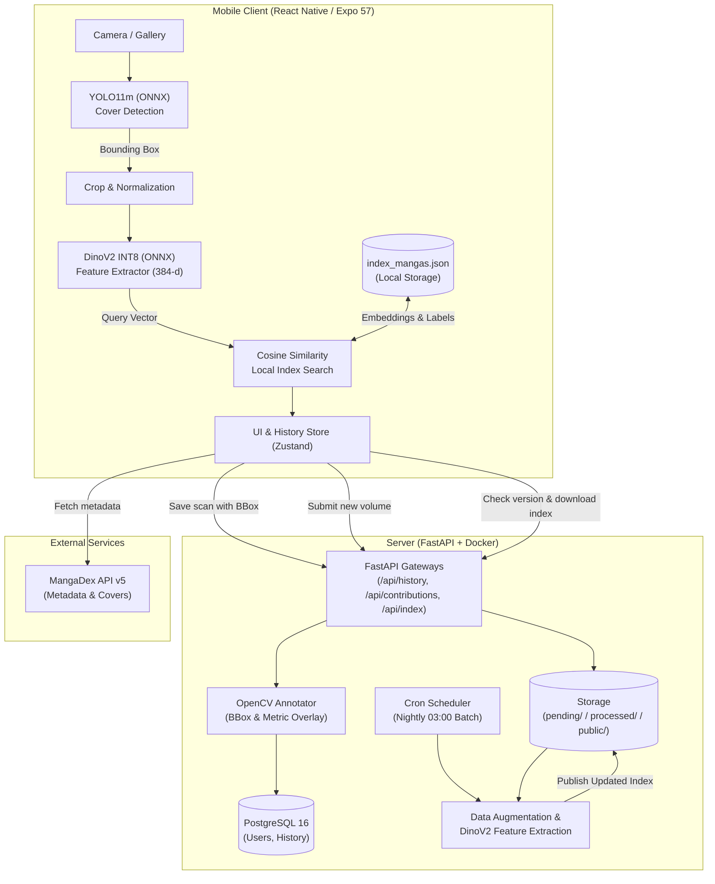

# Manganitor

[](https://reactnative.dev/)
[](https://expo.dev/)
[](https://onnxruntime.ai/)
[](https://fastapi.tiangolo.com/)
[](https://www.postgresql.org/)
[](https://www.docker.com/)
[](https://github.com/)

**Manganitor** is an AI-powered mobile application designed for instant manga volume identification and personal collection management. By combining **Edge AI inference** directly on the smartphone with a **FastAPI backend** and a self-improving vector database, Manganitor recognizes manga covers in real time—even entirely offline.

Developed as part of the **SAE 5.01** academic project (IUT Informatique).

---

## Key Features

- **Offline Edge AI Scanner**: Detects and identifies manga covers directly on-device using quantized ONNX neural network models. No internet connection required for scanning.
- **Two-Stage AI Pipeline**:
  - **YOLO11m** detects and crops the manga cover bounding box with high precision.
  - **DinoV2 (quantized INT8)** computes visual vector embeddings (384-dimensional) invariant to lighting, glare, and angles.
  - **Vector Cosine Matching** compares embeddings against a local index with confidence and margin scoring.
- **MangaDex Integration**: Automatically retrieves official volume titles, release dates, synopsis, author credits, and high-definition cover art.
- **Visual History with OpenCV Overlays**: History entries stored on the backend are processed through an OpenCV pipeline that renders bounding boxes, labels, and similarity badges onto the captured image.
- **Community Contribution & Self-Improving Index**:
  - Users can submit unrecognised or new manga covers directly within the app.
  - A scheduled backend cron service automatically augments contributed images, extracts DinoV2 embeddings, updates the global vector index, and increments the database version.
- **Dynamic Vector Index Sync**: On startup, the mobile app compares its local index version with the backend (`/api/index/version`) and downloads the newest `index_mangas.json` over-the-air without requiring an app store update.
- **Cross-Platform Support**: Built with React Native & Expo Router for Android, iOS, and Web.
- **Automated CI/CD**: Standalone Android APK builds and releases compiled automatically via GitHub Actions.

---

## System Architecture



---

## AI / Machine Learning Pipeline

### 1. On-Device Inference Flow
```
User Photo ──► YOLO11m ONNX ──► Manga Bounding Box [x1, y1, x2, y2]
                     │
                     ▼
             Image Crop & Preprocessing (224x224 RGB, ImageNet Normalized)
                     │
                     ▼
             DinoV2 INT8 ONNX ──► 384-dim Embedding Vector
                     │
                     ▼
             Cosine Similarity vs Local `index_mangas.json`
                     │
                     ├─► Best Match Similarity >= 0.70 & Margin >= 0.05 ──► Match Found!
                     └─► Otherwise ──► Low Confidence / Unrecognized
```

### 2. Contribution & Index Update Pipeline
When users contribute new volumes:
1. Photo and metadata (`universe`, `volume`) are received via `/api/contributions` and stored in `server/storage/pending/`.
2. The nightly batch runner (`server/docker/cron_runner.py`) wakes up at **03:00**:
   - Generates 3 augmented variations per image (affine transforms, illumination, color jitter).
   - Computes embeddings using DinoV2 via PyTorch.
   - Appends entries to `server/storage/public/index_mangas.json`.
   - Increments `server/storage/public/version.json`.
   - Moves processed files to `server/storage/processed/`.
3. Client apps check the version on app start and download the delta without requiring native binary recompilation.

---

## Tech Stack

### Client (`src/`)
- **Framework**: React Native `0.86.3` with Expo SDK `57`
- **Routing**: Expo Router `v57` (File-based, Typed Routes)
- **State Management**: Zustand `5.0`
- **Edge AI**:
  - `onnxruntime-react-native` (Native Android/iOS execution)
  - `onnxruntime-web` (Web fallback)
- **Camera & Media**: `expo-camera`, `expo-image-picker`, `expo-image`
- **Storage**: `@react-native-async-storage/async-storage`, `expo-file-system`
- **Styling**: Modular theme tokens (`colors`, `spacing`, `radius`)

### Server (`server/`)
- **Language & Engine**: Python `3.11`, FastAPI, Uvicorn
- **ORM & Database**: SQLModel / SQLAlchemy, PostgreSQL 16
- **Computer Vision & AI**: PyTorch `2.2+`, Torchvision, OpenCV (`opencv-python-headless`), Pillow, NumPy
- **Auth**: JWT (`pyjwt`), password hashing (`bcrypt`)
- **HTTP Client**: HTTPX (for MangaDex caching and proxying)
- **Containerization**: Docker Compose (multi-service architecture)

---

## Repository Structure

```text
SAE_5/
├── .github/
│   └── workflows/
│       └── build.yaml          # Automated APK build & GitHub release workflow
├── rapports/                   # Academic progress reports (SAE 5.01)
├── server/                     # Backend API & Worker
│   ├── controller/             # FastAPI route controllers
│   │   ├── contribution_controller.py
│   │   ├── history_controller.py
│   │   ├── index_controller.py
│   │   ├── mangadex_controller.py
│   │   └── user_controller.py
│   ├── docker/
│   │   ├── cron_runner.py      # Scheduled batch retraining worker
│   │   └── Dockerfile          # Python 3.11 image with OpenCV & PyTorch
│   ├── pipeline/               # Image processing & AI scripts
│   │   ├── annotate.py         # OpenCV bounding box and text annotation
│   │   ├── augment.py          # Data augmentation views generator
│   │   ├── extract.py          # DinoV2 feature extraction
│   │   └── update_index.py     # Batch index updater
│   ├── storage/                # Pending, processed, and public artifacts
│   ├── compose.yaml            # Docker Compose multi-container spec
│   ├── config.py               # Server configurations & env variables
│   ├── database.py             # Database engine & session creation
│   ├── init_db.sql             # PostgreSQL schema definition
│   ├── main.py                 # FastAPI application entrypoint
│   └── requirements.txt        # Python backend dependencies
└── src/                        # Mobile Client (React Native / Expo)
    ├── assets/
    │   ├── images/             # App icons, splash screens, badges
    │   └── models/             # ONNX models (yolo.onnx, dinov2_int8.onnx, index)
    ├── src/
    │   ├── app/                # Expo Router screens
    │   │   ├── (auth)/         # Login & registration
    │   │   ├── (tabs)/         # Bottom navigation tabs
    │   │   │   ├── index.tsx       # Scanner (Camera & Edge AI Inference)
    │   │   │   ├── details.tsx     # Manga details & MangaDex metadata
    │   │   │   ├── history.tsx     # Scan history with annotated images
    │   │   │   ├── contribute.tsx  # User contribution submission
    │   │   │   └── about.tsx       # App info & credits
    │   │   └── _layout.tsx     # Root stack & notifications
    │   ├── components/         # Reusable UI components
    │   ├── services/           # AI classifier, index sync, API clients
    │   ├── stores/             # Zustand stores (detection, auth, history, etc.)
    │   ├── theme/              # Color palette & typography design tokens
    │   ├── types/              # Centralized TypeScript definitions
    │   └── utils/              # Helper utilities
    ├── app.json                # Expo application configuration
    └── package.json            # Node.js dependencies & scripts
```

---

## Getting Started

### Prerequisites
- **Node.js**: v20 or v22 (LTS recommended)
- **Python**: 3.11+ (if running backend without Docker)
- **Docker & Docker Compose**: For containerized backend deployment
- **Android Studio / JDK 17**: If compiling the native Android app locally

---

### 1. Backend Setup (Docker Compose)

The easiest way to start the backend with PostgreSQL, FastAPI, and the Cron Scheduler is using Docker Compose:

1. Navigate to the `server/` directory:
   ```bash
   cd server
   ```

2. Create a `.env` file from your configuration:
   ```env
   DB_USER=manganitor
   DB_PASSWORD=manganitor_secret
   DB_NAME=manganitor_db
   DB_PORT=5432
   SERVER_HOST=0.0.0.0
   SERVER_PORT=8000
   JWT_SECRET=your-super-secret-jwt-key
   BATCH_API_KEY=your-optional-batch-key
   ```

3. Build and launch all services:
   ```bash
   docker compose up -d --build
   ```

   The compose setup starts 3 services:
   - `manganitor_api`: FastAPI server running at `http://localhost:8001`
   - `manganitor_scheduler`: Cron service for nightly index updates
   - `manganitor_db`: PostgreSQL 16 (persisted in named volume `pg_data`)

> [!NOTE]
> Database data is safely persisted in the `pg_data` volume. You can rebuild the API (`docker compose up -d --build api`) at any time without losing data.

---

### 2. Mobile App Setup (React Native / Expo)

1. Navigate to the `src/` directory:
   ```bash
   cd src
   ```

2. Install dependencies:
   ```bash
   npm install
   ```
   *(A post-install hook automatically applies Gradle compatibility patches for `onnxruntime-react-native`).*

3. Configure your API endpoint:
   Update `src/src/services/apiService.ts` or provide your development server address:
   ```typescript
   // Use your local LAN IP when testing on a physical device (e.g., http://192.168.1.X:8001)
   export const API_URL = "http://localhost:8001";
   ```

4. Run the development server:
   ```bash
   # Start Expo Metro Bundler
   npx expo start

   # Or run directly on an Android emulator / USB device
   npm run android

   # Or run the Web preview
   npm run web
   ```

---

## API Endpoints Overview

| Method | Endpoint | Description | Auth Required |
|---|---|---|---|
| `POST` | `/api/users/register` | Register a new user | No |
| `POST` | `/api/users/login` | Authenticate and obtain JWT token | No |
| `GET` | `/api/users/me` | Fetch authenticated user profile | Yes |
| `GET` | `/api/history` | List user scan history entries | Yes |
| `POST` | `/api/history` | Upload scan result (generates OpenCV annotation) | Yes |
| `DELETE`| `/api/history/{id}` | Delete history entry | Yes |
| `POST` | `/api/contributions` | Submit a new manga cover for retraining | Yes |
| `GET` | `/api/index/version` | Get the current vector database version | No |
| `GET` | `/api/index/download`| Download the latest `index_mangas.json` | No |
| `GET` | `/api/mangadex/search` | Search manga series by title | No |
| `GET` | `/api/mangadex/manga/{title}` | Fetch manga metadata & volumes | No |

---

## Building Standalone APK (CI/CD)

The project includes a production-grade GitHub Actions workflow (`.github/workflows/build.yaml`) that compiles a release APK using **JDK 17** and **Gradle 9** compatibility adjustments:

1. **Triggering manually**:
   - Go to **Actions** > **Build & Release APK** > **Run workflow**.
   - Optionally provide a custom version (e.g. `1.0.0`).
2. **Triggering via Git Tag**:
   - Push a semantic version tag:
     ```bash
     git tag v1.0.0
     git push origin v1.0.0
     ```
3. The APK artifact is automatically compiled, signed, and published to the GitHub repository's **Releases** tab.

---

## Authors & Academic Context

This project was developed within the context of **SAE 5.01** at **IUT Informatique**:
- **Matteo Plancher** & Team
- Supervised by academic faculty.

Special thanks to:
- [MangaDex](https://mangadex.org) for their open manga metadata API.
- The [ONNX Runtime](https://onnxruntime.ai) and [Meta Research (DinoV2)](https://github.com/facebookresearch/dinov2) teams.
